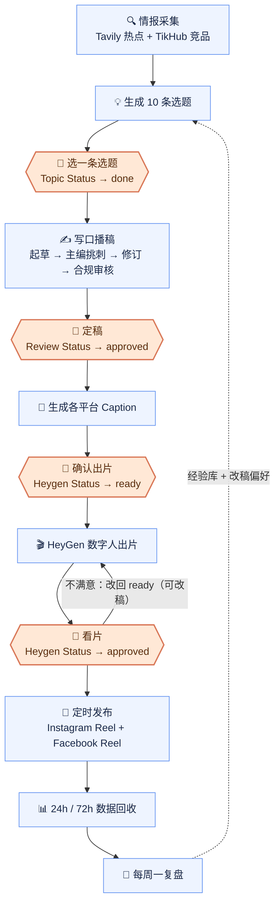
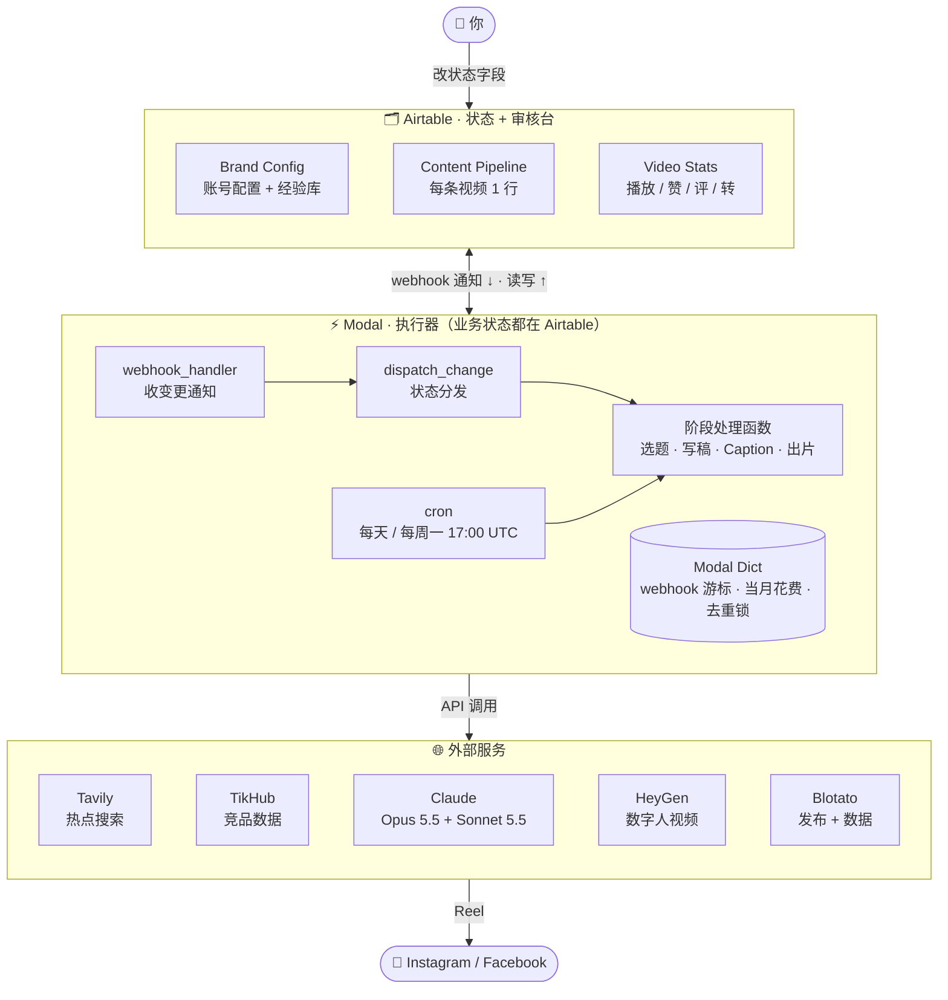
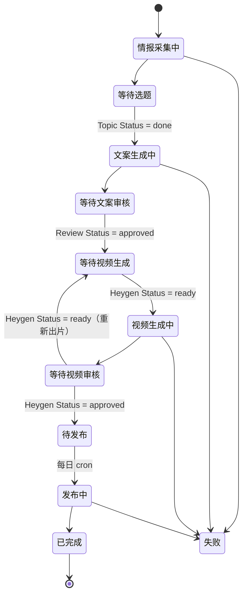
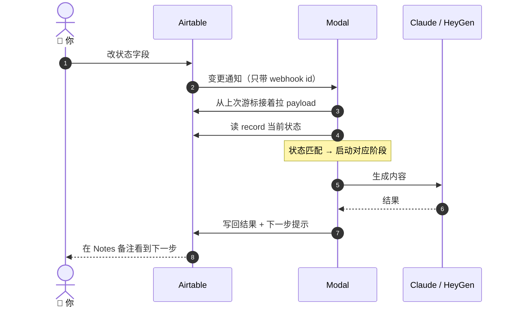

<div align="center">

# 🎬 Oral Video Director

### 全自动口播视频生产系统 · koubo-opc-sys

情报采集 → 选题 → 写稿 → 数字人出片 → 发布 → 数据回收 → 周复盘<br/>
全流程自动跑，你只在 Airtable 里点 4 次审核。


</div>

---

## 📌 一眼看懂

| | |
|---|---|
| **做什么** | 每天自动产出 1 条口播短视频，发到 Instagram + Facebook |
| **谁来审** | 你。4 个审核点，全部在 Airtable 改一个状态字段 |
| **跑在哪** | Modal（serverless，免费额度够用），无需自己的服务器 |
| **越用越准** | 每周复盘播放数据 + 你的改稿习惯，写回经验库，下一轮直接用 |
| **成本** | 主要是 HeyGen 渲染：每天 1 条约 US$4（详见[成本](#-成本)） |

---

## 🔄 生产流程

橙色 = 需要你动手的审核点，其余全自动。



---

## 🏗 系统架构

**Airtable 是唯一的状态存储和审核台；Modal 只存 webhook 游标 / 当月花费 / 去重锁这几项簿记，所有业务状态都在 Airtable。**



| 层 | 位置 | 职责 |
|---|---|---|
| 状态层 | Airtable 3 张表 | 所有流程状态、内容、数据都在这里 |
| 编排层 | [`modal_app.py`](modal_app.py) | 状态机 + cron + webhook，各阶段用 `.spawn()` 异步接力 |
| 能力层 | [`core/`](core) | 每个模块封装一个外部服务，互不依赖 |

---

## 🚦 状态机

`Content Pipeline` 表的 `Current Stage 当前状态` 字段：



任意阶段出错 → `失败`，原因写在 `Notes 备注` 字段，并推送告警。

### 一次审核是怎么触发下一步的



---

## 👤 你要做的 4 件事

| # | 在哪个阶段 | 你做什么 | 改哪个字段 |
|---|---|---|---|
| 1 | 等待选题 | 从 10 条里选 1 条，填进 `Final Topic` | `Topic Status` → `done` |
| 2 | 等待文案审核 | 选钩子 + 正文 + CTA，拼好填进 `Final Script` | `Review Status` → `approved` |
| 3 | 等待视频生成 | 确认各平台 Caption | `Heygen Status` → `ready` |
| 4 | 等待视频审核 | 看片。满意就放行；不满意改稿后改回 `ready`（不改稿也会重新出片） | `Heygen Status` → `approved` |

> 💡 `Scheduled Publish Time` 留空 = 下一次每日定时任务发布；填了日期 = 到那天发布。<br/>
> ⚠️ 重新出片会再收一次 HeyGen 渲染费，文字问题尽量在第 2 步改掉。

---

## 🧠 模型分层

| 任务 | 模型 | 思考深度 |
|---|---|---|
| 选题、主编挑刺、合规审核、Caption 改写、账号定位摘要 | `claude-sonnet-5-5` | `low` |
| 口播起草、修订、周复盘 | `claude-opus-5-5` | `medium` |

- 一条文案 = 4 次调用：起草 → 挑刺 → 修订 → 合规审核
- 全部走结构化输出（`output_config.format` + JSON Schema），拿到的直接是已解析的 dict
- 可用 `MODEL_CHEAP` / `MODEL_QUALITY` / `EFFORT_CHEAP` / `EFFORT_QUALITY` 覆盖
- 统一封装在 [`core/llm.py`](core/llm.py)

### 学习闭环

- 每周一读取 `Video Stats` + 最近的「AI 原稿 vs 你的终稿」
- 结论追加到 `Brand Config` 的 `AI Experience Notes`（保留最近约 6000 字）
- 之后每次选题、写稿的 prompt 都会带上这段经验

---

## 📁 目录结构

```
koubo-opc-sys/
├── modal_app.py            # 主程序：状态机 + cron + webhook 端点
├── webhook_register.py     # Airtable webhook 注册 / 续期 / 查看
├── core/
│   ├── airtable_client.py  # 所有 Airtable 读写的唯一出口
│   ├── llm.py              # Claude 封装：模型分层 + 结构化输出
│   ├── intelligence.py     # 情报采集（Tavily + TikHub）
│   ├── topic_generator.py  # 选题生成
│   ├── copywriter.py       # 写稿三步走 + 合规审核
│   ├── platform_adapter.py # 各平台 Caption 改写
│   ├── video_generator.py  # HeyGen 提交 + 查询
│   ├── publisher.py        # Blotato 发布 + 数据回收
│   ├── retry.py            # 429 / 5xx / 网络错误指数退避
│   └── notifier.py         # Slack / Discord 告警
├── .env.template           # 环境变量模板
├── .mcp.json               # Airtable MCP 配置
├── CLAUDE.md               # 完整安装 + 使用文档
├── 快速开始.md              # 上手指南 + 改动记录
└── AI口播编导系统构建 SOP.docx
```

---

## 🚀 快速开始

1. 装好 [Claude Code](https://claude.com/claude-code) 和 Python 3.11+
2. 在本目录打开 Claude Code
3. 输入：

   ```
   start the agent
   ```

   它会用中文引导你填 API key → 复制 Airtable 模板 → 部署到 Modal，约 30–45 分钟。

想自己动手：看 [`CLAUDE.md`](CLAUDE.md) 第 5 章的逐步安装流程。

### 需要的账号

| 服务 | 用途 | 必需 |
|---|---|---|
| [Anthropic](https://console.anthropic.com) | 选题 / 写稿 / 复盘 | ✅ |
| [HeyGen](https://app.heygen.com) | 数字人出片（主要成本） | ✅ |
| [Blotato](https://app.blotato.com) | 发布 IG / FB + 拉数据 | ✅ |
| [Tavily](https://tavily.com) | 行业热点搜索 | ✅ |
| [Airtable](https://airtable.com) | 数据库 + 审核台 | ✅ |
| [Modal](https://modal.com) | 云端运行 | ✅ |
| [TikHub](https://tikhub.io) | TikTok 竞品监控 | 可选 |

---

## ⏰ 定时任务

| 时间（UTC） | 任务 |
|---|---|
| 每天 17:00 | ① 新建当天流水线（情报 + 选题）在 cron 本体跑；② 发布到期视频、③ 回收 24h / 72h 数据、④ webhook 续期 各自拆成独立函数并行跑，互不阻塞 |
| 每周一 17:00 | 周复盘，更新经验库 |

17:00 UTC = 美东 12:00（冬令时）= 北京 / 吉隆坡次日 01:00。所有日期判断都按 UTC。

---

## 💰 成本

| 项目 | 参考 |
|---|---|
| HeyGen 渲染 | 按秒计费。每天 1 条约 US$4，每天 3 条约 US$11（常规数字人，60–90 秒） |
| Claude | 约 US$0.2–0.5 一条（按 token 估算，未实测，以账单为准） |
| Modal | 免费额度内 |

**内置护栏**

- `MONTHLY_BUDGET_USD`：当月 HeyGen 花费到上限自动停止出片，每月重置
- 跨过 50% / 80% / 100% 时推送告警到 `ALERT_WEBHOOK_URL`
- 护栏只统计 HeyGen，Claude / Tavily / TikHub 的花费不计入

---

## ⚠️ 已知限制

- 只自动发布 Instagram 和 Facebook；TikTok / YouTube 的 Caption 会生成但需手动发
- Webhook 端点不校验 Airtable 签名（端点收到通知后自己回 Airtable 拉数据，不信任请求内容）
- Airtable 通知是 at-least-once：同一条 record 偶尔会被重复分发。四个阶段处理函数都有按「record + 内容 hash」的原子去重锁，成功后再提交同样内容会被跳过（见 CLAUDE.md §7「改了状态没反应」）
- 预算护栏只统计 HeyGen；Claude / Tavily / TikHub 花费不计入
- 所有日期判断按 UTC（cron 17:00 UTC = 北京/吉隆坡次日 01:00）

---

## 📚 文档

| 文档 | 内容 |
|---|---|
| [`快速开始.md`](快速开始.md) | 上手步骤、成本、改动记录 |
| [`CLAUDE.md`](CLAUDE.md) | 状态机详解、Airtable 表结构、逐步安装、排错 |
| `AI口播编导系统构建 SOP.docx` | 图文版构建 SOP |
